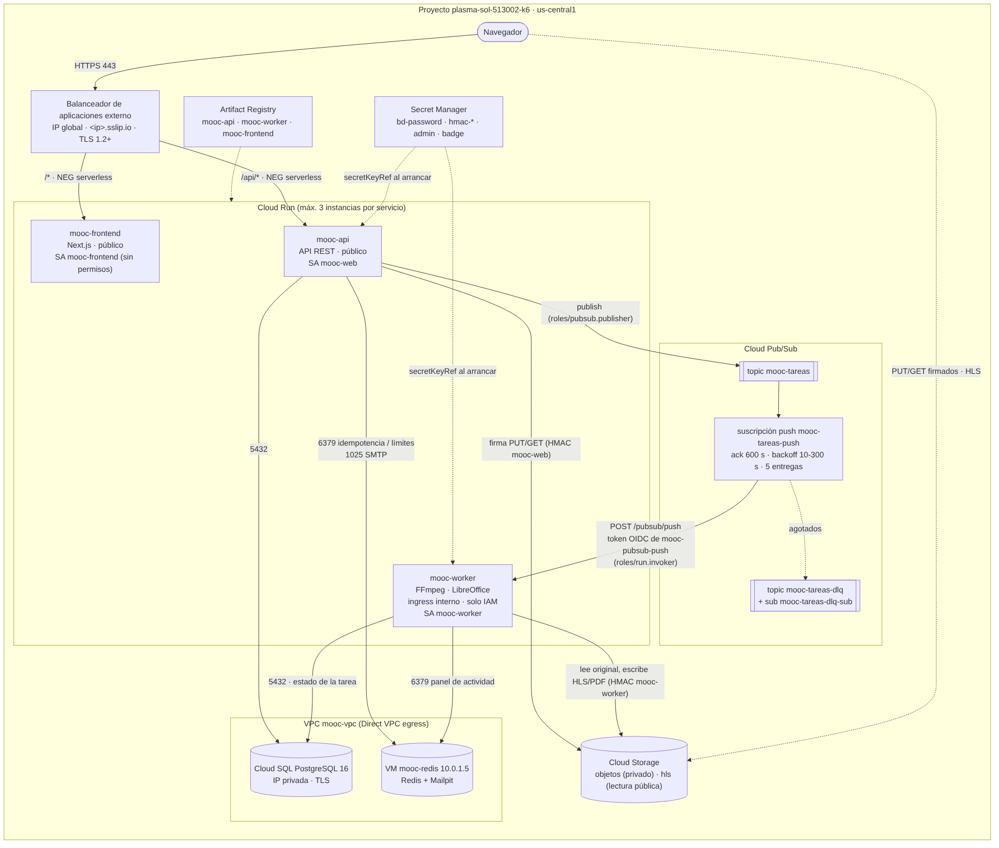

# Entrega 4 — Despliegue en Cloud Run y Cloud Pub/Sub

La plataforma MOOC de las entregas anteriores corre ahora en **tres servicios
de Cloud Run** (frontend, backend y workers) con imágenes de Artifact Registry,
y las tareas asíncronas (transcodificación HLS y conversión de presentaciones
a PDF) viajan por **Cloud Pub/Sub** con una **suscripción push autenticada**
hacia los workers. Se parte del mismo código y de las mismas funcionalidades:
lo que cambia es dónde corre cada pieza y el transporte de los trabajos.

| | |
|---|---|
| Guía de despliegue | [Sección 5](#5-guía-reproducible-de-despliegue) |
| Diagrama | [`arquitectura.png`](arquitectura.png) (fuente: [`arquitectura.mmd`](arquitectura.mmd)) |
| Evidencias | [`evidencias.md`](evidencias.md) |
| Verificación de escalamiento | [`evidencias.md#escalamiento`](evidencias.md#escalamiento), scripts en [`load/entrega4/`](../../load/entrega4/) |
| Infraestructura como código | [`deploy/gcp/terraform/cloudrun.tf`](../../deploy/gcp/terraform/cloudrun.tf), [`pubsub.tf`](../../deploy/gcp/terraform/pubsub.tf), [`balanceador.tf`](../../deploy/gcp/terraform/balanceador.tf) |
| Video de sustentación | _enlace pendiente (máx. 20 min)_ |

---

## 1. Arquitectura desplegada



```
Navegador ──HTTPS──> Balanceador externo (IP global, <ip>.sslip.io, certificado administrado)
                       ├─ /api/*  ─ NEG serverless ─> Cloud Run mooc-api ──publish──> Pub/Sub mooc-tareas
                       └─ resto   ─ NEG serverless ─> Cloud Run mooc-frontend               │
                                                                                              │ push + OIDC
                       Cloud Run mooc-worker <────────────────────────────────────────────────┘
                       (ingress interno, run.invoker solo para mooc-pubsub-push)
   mooc-api y mooc-worker ─ Direct VPC egress ─> Cloud SQL (IP privada) y VM mooc-redis (10.0.1.5)
   mooc-api y mooc-worker ─────────────────────> Cloud Storage (API XML, HMAC por servicio)
```

**Por qué se conserva el balanceador.** Las cookies de sesión son
`SameSite=Lax` y `Secure`. `run.app` está en la Public Suffix List, así que
`mooc-frontend-….run.app` y `mooc-api-….run.app` son *sitios distintos*: el
navegador no enviaría la cookie de sesión en las llamadas del frontend a la
API y la autenticación existente dejaría de funcionar. Con el balanceador y
NEG serverless, frontend y API siguen bajo el **mismo origen**
(`https://<ip>.sslip.io`), con el mismo certificado de la Entrega 3, y la
autenticación (sesión httpOnly + token CSRF) no cambia. El CORS de la API
admite solo ese origen (`PUBLIC_BASE_URL`) y el de los buckets también.

**Qué salió.** Los dos MIG de la Entrega 3 (API+frontend y workers), sus
plantillas, autoscalers, health checks y la regla de firewall del balanceador.
Siguen la VM de Redis (idempotencia de peticiones, límites de tasa, panel de
actividad y Mailpit), Cloud SQL, los buckets, Artifact Registry y Secret
Manager. asynq sigue disponible para desarrollo local (`QUEUE_BACKEND=asynq`,
el valor por defecto en `docker-compose.yml`).

## 2. Servicios de Cloud Run

Región **us-central1** para los tres. Un contenedor de aplicación por
instancia. Valores en [`variables.tf`](../../deploy/gcp/terraform/variables.tf)
(`run_api`, `run_frontend`, `run_worker`); Terraform rechaza un máximo mayor
que 3.

| | Frontend `mooc-frontend` | Backend `mooc-api` | Workers `mooc-worker` |
|---|---|---|---|
| Responsabilidad | Servir la interfaz (Next.js standalone) | API REST, autenticación, firma de cargas, publicar tareas | Recibir mensajes push y ejecutar FFmpeg / LibreOffice |
| Imagen | `mooc-frontend:<commit>` | `mooc-api:<commit>` | `mooc-worker:<commit>` |
| Instancias mín. / **máx.** | 0 / **3** | 0 / **3** | 0 / **3** |
| CPU / memoria | 1 vCPU / 512 MiB | 1 vCPU / 512 MiB | 2 vCPU / 4 GiB |
| Concurrencia (peticiones por instancia) | 80 | 80 | **1** (una tarea por instancia) |
| Tiempo máximo de solicitud | 60 s | 600 s (confirmar una carga verifica el archivo entero) | 600 s (= ack deadline) |
| Facturación de CPU | Solo durante peticiones | Solo durante peticiones | Solo durante peticiones (la tarea corre dentro de la petición push) |
| Ingress | Todo (tráfico normal por el balanceador) | Todo (tráfico normal por el balanceador) | **Solo interno** |
| Invocación | `allUsers` | `allUsers` (la API tiene su propia autenticación) | **Solo `mooc-pubsub-push`** |
| Cuenta de servicio | `mooc-frontend` (sin roles) | `mooc-web` | `mooc-worker` |
| Red de salida | Internet | Direct VPC egress, subred `mooc-api`, `PRIVATE_RANGES_ONLY` | Direct VPC egress, subred `mooc-workers`, `PRIVATE_RANGES_ONLY` |
| Sonda de arranque | TCP 3000 | `GET /healthz` (la API migra la base al arrancar) | `GET /healthz` |

**Mínimo 0.** No se exige mantener instancias activas: sin tráfico ningún
servicio cobra cómputo. El costo es el arranque en frío (unos segundos) de la
primera petición tras un rato sin uso.

**Concurrencia 1 en los workers.** Cada tarea es un FFmpeg o un LibreOffice
que ocupa la CPU entera. Con concurrencia 1, Cloud Run escala por mensajes
pendientes: cada entrega push simultánea necesita su propia instancia, hasta
el máximo de 3. El resto espera en la suscripción y Pub/Sub las reentrega con
backoff.

**Sin estado local.** El sistema de archivos de Cloud Run vive en memoria y
desaparece con la instancia. Todo lo persistente está fuera: datos y estado
de las tareas en Cloud SQL, archivos en Cloud Storage, idempotencia y límites
de tasa en Redis. El worker usa `/tmp` solo como espacio de trabajo durante
una tarea (por eso 4 GiB).

## 3. Tareas asíncronas con Pub/Sub

| Recurso | Configuración |
|---|---|
| Topic `mooc-tareas` | Retención de 1 día: si los workers no pueden arrancar, las tareas esperan. |
| Suscripción push `mooc-tareas-push` | Endpoint `https://mooc-worker-….run.app/pubsub/push`; **token OIDC** de `mooc-pubsub-push` con audiencia = URL del servicio; ack deadline 600 s; retry policy 10 s a 300 s; **dead-letter** tras 5 entregas. |
| Topic `mooc-tareas-dlq` + `mooc-tareas-dlq-sub` | Mensajes agotados, para inspeccionarlos (`gcloud pubsub subscriptions pull mooc-tareas-dlq-sub`). |

**Recorrido de una tarea** (código en
[`queue/pubsub.go`](../../backend/internal/platform/queue/pubsub.go) y
[`queue/push.go`](../../backend/internal/platform/queue/push.go)):

1. El profesor sube el original directo al bucket con la URL firmada y
   confirma la carga (`POST …/confirm-upload`).
2. La API verifica el archivo, deja el recurso en `pending`, **publica** un
   mensaje en `mooc-tareas` con atributos `tipo` y `clave_idempotencia` (el id
   del activo) y responde `202` sin esperar la ejecución. Registro:
   `accion=queue.task_published` con el `message_id`.
3. Pub/Sub entrega el mensaje por push a `mooc-worker`. Cloud Run valida el
   token OIDC antes de que la petición llegue al contenedor. Registro:
   `accion=queue.task_received` con `message_id` e `intento` (deliveryAttempt).
4. El worker reclama el activo con un `UPDATE` condicional (arrendamiento),
   transcodifica, sube el HLS y marca el activo y el recurso `ready` en Cloud
   SQL.
5. **Solo después de persistir** responde `204`: ese es el ack. Registro:
   `accion=queue.task_acked`.
6. La interfaz del profesor consulta el estado del recurso y pasa de
   «Procesando» a «Listo» (`processing_status`): así se verifica la
   finalización desde la aplicación.

**Confirmación, reintentos y duplicados.**

| Resultado del manejador | Respuesta | Efecto en Pub/Sub |
|---|---|---|
| Éxito (estado persistido) | `204` | ack |
| Error permanente (original ilegible: ya marcado `failed`) o tipo desconocido | `204` | ack, sin reintentos inútiles |
| Error transitorio (BD, Storage) | `500` | nack: reentrega con backoff; en la 5.ª, dead-letter y registro `queue.task_dead_letter` |
| Activo arrendado por otra entrega en curso | `503` | nack: vuelve más tarde |
| Instancia en retiro (SIGTERM de Cloud Run) | `503` | El worker corta FFmpeg, libera el activo y Pub/Sub reentrega a otra instancia |

Pub/Sub entrega **al menos una vez**. Una reentrega (ack perdido, timeout,
nack) no duplica efectos: el reclamo del activo es atómico en Cloud SQL, una
entrega de un activo ya `ready` se descarta con ack (`media: entrega duplicada
descartada`) y una que llega mientras otra lo procesa recibe nack hasta que
la primera termina. Además, la API publica con la clave de idempotencia del
activo y la confirmación HTTP está protegida por la cabecera
`Idempotency-Key` (Redis), así que un doble clic no genera dos tareas con
efecto.

## 4. Configuración y acceso

**Cuentas de servicio** (las crea [`bootstrap-ci.sh`](../../deploy/gcp/bootstrap-ci.sh);
los permisos están en Terraform):

| Cuenta | Para qué | Permisos (todos sobre el recurso concreto, salvo registros/métricas) |
|---|---|---|
| `mooc-web` | Servicio `mooc-api` | `pubsub.publisher` **solo** en el topic `mooc-tareas`; `secretAccessor` en `bd-password`, `hmac-web-secret`, `admin-password`, `badge-signing-key`; lectura/escritura en el bucket de objetos; `logWriter`, `metricWriter` |
| `mooc-worker` | Servicio `mooc-worker` | `secretAccessor` en `bd-password` y `hmac-worker-secret`; leer originales y escribir derivados en los buckets; `logWriter`, `metricWriter`. **No** puede publicar en Pub/Sub ni leer los secretos de la API |
| `mooc-frontend` | Servicio `mooc-frontend` | Ninguno |
| `mooc-pubsub-push` | Identidad OIDC de la suscripción push | `run.invoker` **solo** sobre `mooc-worker` |
| Agente de Pub/Sub (`service-<n>@gcp-sa-pubsub`) | Mover mensajes agotados a la dead-letter | `pubsub.publisher` en `mooc-tareas-dlq`, `pubsub.subscriber` en `mooc-tareas-push` |
| `mooc-deployer` | CI (GitHub Actions, Workload Identity) | Roles de despliegue, ahora con `run.admin` y `pubsub.admin`; `serviceAccountUser` solo sobre las cuentas anteriores |

**Workers protegidos, en dos capas.** Ingress `internal`: desde Internet la URL
del worker responde 404 aunque se presente un token. IAM: aun desde dentro,
Cloud Run rechaza con 403 cualquier identidad que no sea `mooc-pubsub-push`.
La API no puede invocar al worker: solo puede publicar en el topic.

**Configuración y secretos.** La configuración va en variables de entorno de
cada servicio (Terraform). Los secretos van como referencias a **Secret
Manager** (`secretKeyRef`, versión `latest`) que Cloud Run resuelve al
arrancar cada instancia con la cuenta del servicio: `DB_PASSWORD`,
`S3_SECRET_KEY`, `BADGE_SIGNING_KEY` y `ADMIN_PASSWORD`. No hay claves ni
contraseñas en el repositorio ni en las imágenes; la API publica en Pub/Sub
con un token del servidor de metadatos (sin llaves JSON). La URL de la base
se arma en el proceso a partir de `DB_HOST`, `DB_USER`, `DB_NAME` y
`DB_PASSWORD` ([`config.go`](../../backend/internal/config/config.go)).

**Red.** API y workers salen a la VPC con Direct VPC egress y etiquetas de
red `mooc-run-api` / `mooc-run-worker`. El firewall deja llegar al 5432 de
Cloud SQL solo a esas etiquetas (el resto de la VPC tiene el egress al rango
de Cloud SQL denegado), al 6379 de Redis solo desde las subredes de API y
workers y al 1025 (SMTP) solo desde la de la API.

## 5. Guía reproducible de despliegue

Requisitos: `gcloud`, `terraform` ≥ 1.7, `docker` con buildx, `git`, `jq`.
**Cloud Shell los trae todos**, y allí Terraform usa la sesión sin más
pasos. Proyecto: `plasma-sol-513002-k6`, región `us-central1`.

```bash
git clone https://github.com/DES-SOLUCIONES-CLOUD/proyecto-1.git && cd proyecto-1
gcloud config set project plasma-sol-513002-k6

# 1. (una vez, el dueño) cuentas de servicio, incluidas mooc-frontend y
#    mooc-pubsub-push, bucket del estado y permisos de CI
deploy/gcp/bootstrap-ci.sh --proyecto plasma-sol-513002-k6

# 2. variables (sin secretos)
cp deploy/gcp/terraform/terraform.tfvars.example deploy/gcp/terraform/terraform.tfvars

# 3. imágenes + infraestructura + revisiones de Cloud Run, todo con el commit como etiqueta
deploy/gcp/desplegar-run.sh
#    = publicar.sh           construye api, worker, frontend (con la URL del balanceador) y las sube
#                            a us-central1-docker.pkg.dev/plasma-sol-513002-k6/mooc/mooc-*:<commit>
#    + desplegar-infra.sh    habilita run y pubsub, terraform apply: Cloud Run, Pub/Sub, IAM, NEG, firewall
#    + desplegar-imagenes.sh gcloud run services update --image ...:<commit> (worker, api, frontend)

# Despliegues posteriores de código (lo mismo hace el push a main en GitHub Actions):
deploy/gcp/publicar.sh && deploy/gcp/desplegar-imagenes.sh
```

Recursos que crea o cambia Terraform en esta entrega (`terraform plan` los
lista):

| Archivo | Recursos |
|---|---|
| `cloudrun.tf` | `google_cloud_run_v2_service` api, frontend, worker; `run.invoker` para `allUsers` (api, frontend) y para `mooc-pubsub-push` (worker) |
| `pubsub.tf` | topics `mooc-tareas` y `mooc-tareas-dlq`; suscripciones `mooc-tareas-push` (push OIDC, dead-letter) y `mooc-tareas-dlq-sub`; IAM del topic y del agente de Pub/Sub |
| `balanceador.tf` | NEG serverless `mooc-neg-api` y `mooc-neg-frontend`; backend services `mooc-bs-run-*`; mapa de URL (`/api/*` → API) |
| `main.tf` | firewall de Redis/SMTP por subred y egress a Cloud SQL por etiqueta de red |
| `computo.tf` | se retiran plantillas, MIG, autoscalers y health checks (queda la VM de Redis) |

Comandos equivalentes sin Terraform, para leer qué hace cada pieza:

```bash
P=plasma-sol-513002-k6; R=us-central1; REG=$R-docker.pkg.dev/$P/mooc; TAG=$(git rev-parse --short=12 HEAD)
gcloud services enable run.googleapis.com pubsub.googleapis.com

gcloud pubsub topics create mooc-tareas --message-retention-duration=1d
gcloud pubsub topics create mooc-tareas-dlq
gcloud pubsub subscriptions create mooc-tareas-dlq-sub --topic mooc-tareas-dlq

gcloud run deploy mooc-worker --image $REG/mooc-worker:$TAG --region $R \
  --service-account mooc-worker@$P.iam.gserviceaccount.com --no-allow-unauthenticated --ingress internal \
  --min-instances 0 --max-instances 3 --concurrency 1 --cpu 2 --memory 4Gi --timeout 600 \
  --network mooc-vpc --subnet mooc-workers --network-tags mooc-run-worker --vpc-egress private-ranges-only \
  --set-env-vars QUEUE_BACKEND=pubsub,DB_HOST=<ip privada>,REDIS_ADDR=10.0.1.5:6379,... \
  --set-secrets DB_PASSWORD=mooc-bd-password:latest,S3_SECRET_KEY=mooc-hmac-worker-secret:latest

gcloud run services add-iam-policy-binding mooc-worker --region $R \
  --member serviceAccount:mooc-pubsub-push@$P.iam.gserviceaccount.com --role roles/run.invoker

URL=$(gcloud run services describe mooc-worker --region $R --format 'value(status.url)')
gcloud pubsub subscriptions create mooc-tareas-push --topic mooc-tareas \
  --push-endpoint "$URL/pubsub/push" \
  --push-auth-service-account mooc-pubsub-push@$P.iam.gserviceaccount.com --push-auth-token-audience "$URL" \
  --ack-deadline 600 --min-retry-delay 10s --max-retry-delay 300s \
  --dead-letter-topic mooc-tareas-dlq --max-delivery-attempts 5

gcloud pubsub topics add-iam-policy-binding mooc-tareas \
  --member serviceAccount:mooc-web@$P.iam.gserviceaccount.com --role roles/pubsub.publisher
# api y frontend: igual con --allow-unauthenticated, --max-instances 3, ver cloudrun.tf
```

## 6. Verificación

```bash
# Límites configurados (máximo 3) de cada servicio
for s in mooc-frontend mooc-api mooc-worker; do
  gcloud run services describe $s --region us-central1 \
    --format 'value(metadata.name, spec.template.metadata.annotations["autoscaling.knative.dev/maxScale"], spec.template.spec.containerConcurrency, spec.template.spec.timeoutSeconds)'
done
deploy/gcp/resumen.sh            # tabla con la configuración efectiva leída de GCP

# Workers protegidos
curl -s -o /dev/null -w '%{http_code}\n' "$(gcloud run services describe mooc-worker --region us-central1 --format 'value(status.url)')/pubsub/push" -X POST   # 404 (ingress interno)

# Seguir una tarea: publicación (API) -> recepción -> ack (worker)
gcloud logging read 'resource.type="cloud_run_revision" AND jsonPayload.accion=~"queue.task_(published|received|acked|nacked|dead_letter)"' \
  --freshness 1h --format 'table(timestamp, resource.labels.service_name, jsonPayload.accion, jsonPayload.message_id, jsonPayload.intento)'

# Escalamiento (carga controlada) y métricas de instancias / mensajes pendientes
export MOOC_URL=https://<ip>.sslip.io
python3 load/entrega4/escalamiento.py api --hilos 120 --segundos 120
PROFESOR_EMAIL=... PROFESOR_PASSWORD=... python3 load/entrega4/escalamiento.py workers --videos 9
load/entrega4/metricas.sh 30
```

Los resultados de la corrida están en [`evidencias.md`](evidencias.md).

## 7. Guion del video (≤ 20 min)

| Min. | Qué se muestra |
|---|---|
| 0-2 | Arquitectura (diagrama) y qué cambió frente a la Entrega 3 |
| 2-5 | Aplicación desplegada: login, catálogo, el profesor sube un video |
| 5-9 | Recorrido de la tarea: confirmación `202`, mensaje en Pub/Sub, entrega push al worker, registros `published → received → acked` con el mismo `message_id`, recurso «Listo» y reproducción HLS |
| 9-12 | Configuración: los tres servicios en la consola (máx. 3, CPU, memoria, concurrencia, timeout), topic, suscripción (OIDC, dead-letter) |
| 12-16 | Escalamiento: corrida de `escalamiento.py`, gráfico de instancias por servicio y de mensajes pendientes |
| 16-19 | Acceso y permisos: cuentas de servicio, `run.invoker` del worker, ingress interno (`curl` → 404), secretos en Secret Manager |
| 19-20 | Cierre |
