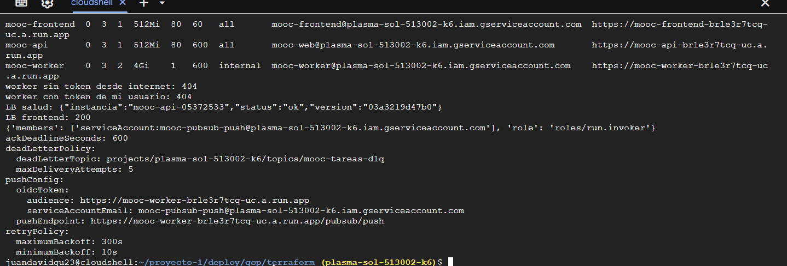
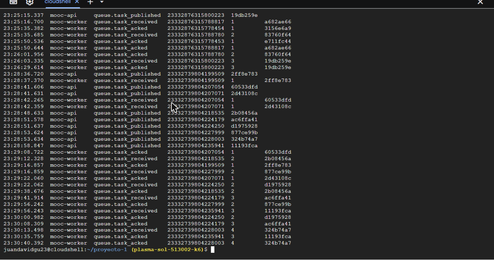
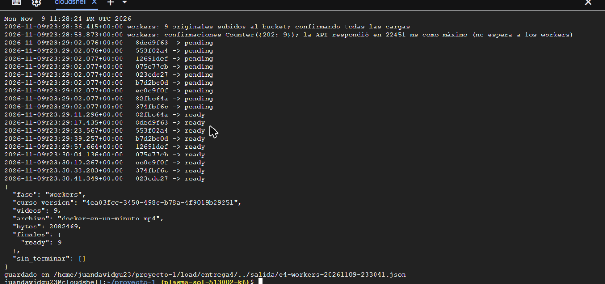
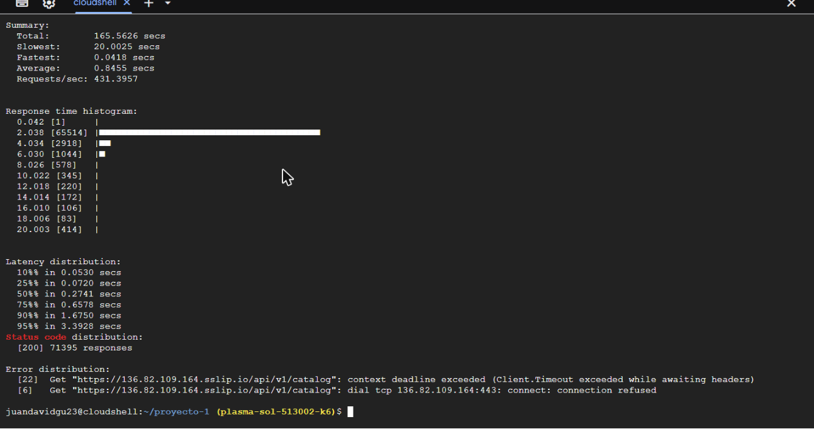
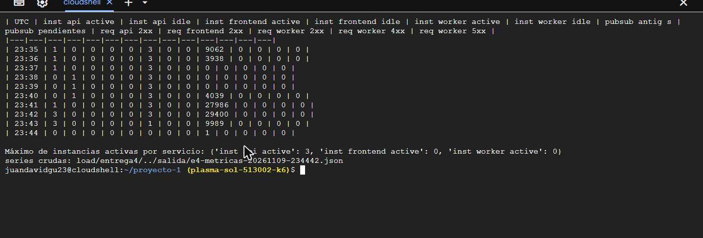
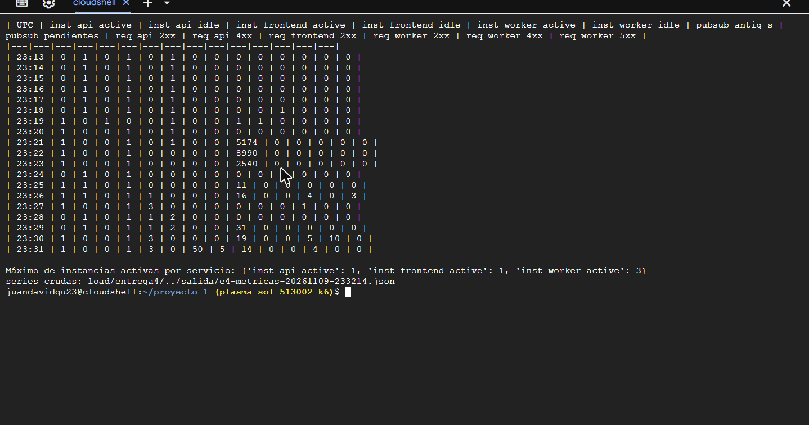

# Entrega 4: Evidencias de funcionamiento

Corrida del **9 de noviembre de 2026** (horas en UTC; Colombia = UTC−5) en el
proyecto `plasma-sol-513002-k6`, región `us-central1`, con las imágenes del
commit `03a3219d47b0` publicadas en Artifact Registry con Cloud Build
(`deploy/gcp/publicar-cloudbuild.sh`, 3 min 36 s).

## URLs

| | URL | Nota |
|---|---|---|
| Frontend | https://136.82.109.164.sslip.io/ | Balanceador → NEG serverless → `mooc-frontend` (respuesta `200`) |
| Backend | https://136.82.109.164.sslip.io/api/v1/health | Balanceador → NEG serverless → `mooc-api`; responde `{"instancia":"mooc-api-05372533","status":"ok","version":"03a3219d47b0"}` |
| Frontend directo | https://mooc-frontend-brle3r7tcq-uc.a.run.app | URL de Cloud Run (la de uso es la del balanceador, ver README §1) |
| Backend directo | https://mooc-api-brle3r7tcq-uc.a.run.app | URL de Cloud Run |
| Workers | https://mooc-worker-brle3r7tcq-uc.a.run.app | Solo Pub/Sub: desde Internet responde `404` (ingress interno), con o sin token |


## Configuración y límites de instancias

Leído de Cloud Run con `~/e4/5-evidencias.sh` (equivalente a
`deploy/gcp/resumen.sh`):

| Servicio | Mín. | **Máx.** | CPU | Memoria | Concurrencia | Timeout | Ingress | Cuenta |
|---|---|---|---|---|---|---|---|---|
| mooc-frontend | 0 | **3** | 1 | 512Mi | 80 | 60 s | all | mooc-frontend |
| mooc-api | 0 | **3** | 1 | 512Mi | 80 | 600 s | all | mooc-web |
| mooc-worker | 0 | **3** | 2 | 4Gi | 1 | 600 s | internal | mooc-worker |

El máximo de 3 está fijado en la revisión (`template.scaling`) y en el
servicio (`scaling`), y Terraform rechaza un valor mayor.

Suscripción push (`gcloud pubsub subscriptions describe mooc-tareas-push`):
`pushEndpoint …/pubsub/push`, `oidcToken.serviceAccountEmail
mooc-pubsub-push@…`, `audience` = URL del worker, `ackDeadlineSeconds 600`,
`retryPolicy 10s–300s`, `deadLetterPolicy → mooc-tareas-dlq`. IAM del worker:
`roles/run.invoker` → **solo** `serviceAccount:mooc-pubsub-push@…`.



## Recorrido de una tarea: publicación → worker → ack

Consulta (`~/e4/6-logs.sh`, o en el Explorador de registros):

```
resource.type="cloud_run_revision" AND jsonPayload.accion=~"queue.task_"
```

Una tarea de la corrida de escalamiento, mensaje `23332739804199509`
(activo `2ff8e783…`):

| Hora (UTC) | Servicio | Evento | Intento |
|---|---|---|---|
| 23:28:36.720 | mooc-api | `queue.task_published` (la API ya respondió `202` al profesor) | - |
| 23:28:37.370 | mooc-worker | `queue.task_received` (push autenticado aceptado por Cloud Run) | 1 |
| 23:29:16.857 | mooc-worker | `queue.task_acked`: HLS subido, activo y recurso `ready` en Cloud SQL, respuesta `204` | 1 |

En la interfaz y en la API (`GET /api/v1/courses/versions/{id}`) el recurso
pasó de `pending` a `ready`: así se verifica la finalización desde la
aplicación.



**Reentregas.** Varios mensajes muestran `intento` 2, 3 y 4 (por ejemplo
`23332739804228003`: recibido en el intento 4 y confirmado una sola vez). Con
los 3 workers ocupados, Cloud Run rechaza la entrega push con `429` antes de
que llegue al contenedor (columna `req worker 4xx` en las métricas) y Pub/Sub
la reintenta con backoff. Ninguna produjo efectos duplicados: 9 recursos, 9
`ready`, un `queue.task_acked` por mensaje. A raíz de esto la suscripción se
dejó en **10 entregas** antes de la dead-letter (`pubsub_max_entregas`), para
que una cola más larga no mande tareas sanas a la DLQ.

## Escalamiento

### Workers: 9 tareas a la vez (mensajes pendientes)

`load/entrega4/escalamiento.py workers --videos 9`: un profesor de prueba
crea un curso borrador con 9 recursos de video, sube el mismo MP4
(`docker-en-un-minuto.mp4`, 2,08 MB) a cada uno y confirma las 9 cargas a la
vez. Cada confirmación publica un mensaje y la API responde `202` sin esperar
a los workers (las 9 respondieron `202`).

| Recurso | `pending` | `ready` |
|---|---|---|
| 82fbc64a | 23:29:02 | 23:29:11 |
| 8ded9f63 | 23:29:02 | 23:29:17 |
| 553f02a4 | 23:29:02 | 23:29:23 |
| b7d2bc0d | 23:29:02 | 23:29:39 |
| 12691def | 23:29:02 | 23:29:57 |
| 075e77cb | 23:29:02 | 23:30:04 |
| ec0c9f0f | 23:29:02 | 23:30:10 |
| 374fbf6c | 23:29:02 | 23:30:38 |
| 023cdc27 | 23:29:02 | 23:30:41 |

Las 9 tareas terminaron en 1 min 39 s, de 3 en 3: con concurrencia 1 cada
tarea ocupa una instancia y Cloud Run llegó al **máximo de 3 instancias
activas** de `mooc-worker` (23:27–23:31), sin pasar de ahí; el resto esperó en
la suscripción (`pubsub pendientes` hasta 2 en las muestras por minuto).



### API: peticiones concurrentes

`hey -z 150s -c 400 https://136.82.109.164.sslip.io/api/v1/catalog` desde
Cloud Shell (23:39:50–23:42:35): 71.395 respuestas `200`, **431 req/s**,
p50 274 ms, p95 3,39 s; 28 errores del lado del cliente (22 timeouts de
20 s y 6 conexiones rechazadas en Cloud Shell).



Instancias de `mooc-api` por minuto (Cloud Monitoring,
`run.googleapis.com/container/instance_count`, máximo del minuto):

| UTC | 23:39 | 23:40 | 23:41 | 23:42 | 23:43 | 23:44 |
|---|---|---|---|---|---|---|
| Instancias activas | 0 (1 idle) | 0 (1 idle) | 1 | **3** | **3** | 0 |
| Peticiones 2xx | 0 | 4.039 | 27.986 | 29.400 | 9.989 | 1 |

La API escaló de 1 a **3 instancias** con la carga y no pasó del máximo
configurado; al terminar volvió a 0 activas.



Antes se probó con el cliente en Python (`escalamiento.py api`, 150 y 300
hilos): el generador se saturó en ~140 req/s y con esa carga una sola
instancia bastó (16.704 y 19.890 respuestas `200`). Por eso la corrida
válida es la de `hey`.



### Cómo repetirla

```bash
export MOOC_URL=https://136.82.109.164.sslip.io
PROFESOR_EMAIL=... PROFESOR_PASSWORD=... python3 load/entrega4/escalamiento.py workers --videos 9
GOBIN=~/bin go install github.com/rakyll/hey@latest && ~/bin/hey -z 150s -c 400 $MOOC_URL/api/v1/catalog
load/entrega4/metricas.sh 20     # tabla por minuto: instancias, peticiones, mensajes pendientes
```

## Observaciones de la corrida

- **Cuenta de prueba.** La contraseña del administrador en Secret Manager ya
  no coincidía con la del administrador del equipo (se cambió desde la
  aplicación), así que para la prueba se creó un administrador aparte,
  `carga-e4@mooc.test`, con la misma clave del secreto `mooc-admin-password`
  (se puso `ADMIN_EMAIL` en la API una vez; el siguiente `terraform apply` lo
  devolvió al valor de `terraform.tfvars`). Conviene desactivarla tras la
  sustentación.
- **Curso de carga.** La corrida dejó el curso borrador «Escalamiento E4 …»
  con 9 videos; no está publicado.
- **Cloud Shell y Artifact Registry.** Desde Cloud Shell, subir capas grandes
  a `*.pkg.dev` fallaba con `connection refused`; por eso existe
  `publicar-cloudbuild.sh` (Cloud Build con una cuenta `mooc-build` que solo
  puede escribir en el repositorio).
