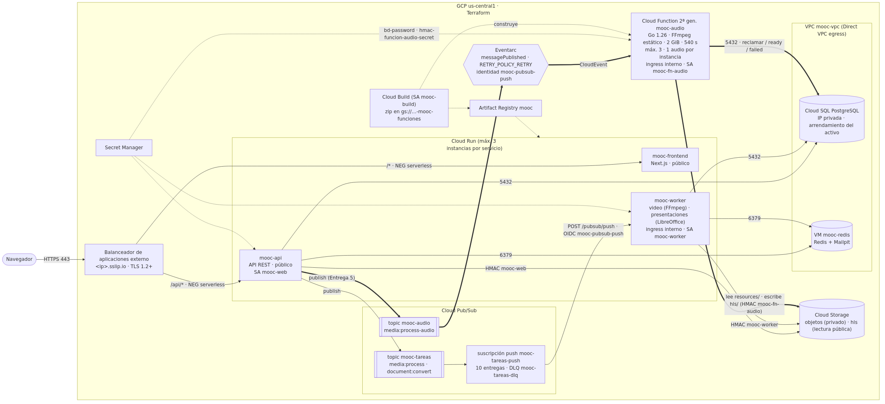

# Entrega 5: Funciones serverless e infraestructura como código

La transcodificación de **audio** sale del worker de Cloud Run y la ejecuta
una **Cloud Function de 2ª generación** (Cloud Run functions) activada por
**Cloud Pub/Sub** a través de Eventarc. El resultado es el mismo de antes
(mismos archivos HLS, mismas claves en el bucket, mismos estados en Cloud
SQL), y toda la arquitectura, incluida la función, se despliega y se
actualiza con `terraform init`, `terraform plan` y `terraform apply`.

| | |
|---|---|
| Análisis de oportunidades | [Sección 1](#1-análisis-serverless) |
| Cambio implementado | [Sección 2](#2-migración-de-la-transcodificación-de-audio) |
| Diagrama | [`arquitectura.png`](arquitectura.png) (fuente: [`arquitectura.mmd`](arquitectura.mmd)) |
| Código de la función | [`backend/funciones/audio/funcion.go`](../../backend/funciones/audio/funcion.go) |
| Terraform | [`deploy/gcp/terraform/`](../../deploy/gcp/terraform/) (la función: [`funcion.tf`](../../deploy/gcp/terraform/funcion.tf)) |
| Guía de despliegue | [Sección 4](#4-despliegue-reproducible) |
| Evidencias | [`evidencias.md`](evidencias.md) |
| Video de sustentación | _(pendiente: enlace)_ |

---

## 1. Análisis serverless

### 1.1 Qué es serverless hoy

| Componente | Servicio | ¿Serverless? | Comentario |
|---|---|---|---|
| Frontend | Cloud Run `mooc-frontend` | Sí | Escala de 0 a 3; se cobra por petición. |
| API | Cloud Run `mooc-api` | Sí | Escala de 0 a 3. |
| Worker (video y presentaciones) | Cloud Run `mooc-worker` | Sí | Escala de 0 a 3 con la cola; push de Pub/Sub. |
| **Transcodificación de audio** | **Cloud Function `mooc-audio`** | **Sí (nuevo)** | Ver sección 2. |
| Cola de tareas | Cloud Pub/Sub | Sí | Topics `mooc-tareas`, `mooc-audio` y la DLQ. |
| Archivos (originales, HLS, PDF) | Cloud Storage | Sí | Sin capacidad que aprovisionar. |
| Secretos | Secret Manager | Sí | Referencias desde Cloud Run y la función. |
| Base de datos | Cloud SQL PostgreSQL | No (administrado) | Instancia con CPU y memoria fijas, se paga encendida. |
| Idempotencia, límites de tasa, panel, SMTP de prueba | VM `mooc-redis` (Compute Engine) | No | VM e2-small siempre encendida. |
| Balanceador | Application Load Balancer | Administrado | Mantiene un solo origen para la cookie de sesión. |
| Apagado nocturno | GitHub Actions (cron) | Fuera de GCP | `apagado-nocturno.yml`. |

### 1.2 Oportunidades

Solo la primera se implementó. El resto queda documentado, como pide el
enunciado.

| # | Componente | Servicio propuesto | Beneficio | Limitaciones |
|---|---|---|---|---|
| **1** | **Transcodificación de audio (worker)** | **Cloud Run functions (2ª gen.) + Pub/Sub/Eventarc** | Unidad de despliegue y escalado propia: un audio no ocupa una instancia de worker de 2 vCPU/4 GiB pensada para video; la función usa 1 vCPU/2 GiB. Escala a 0. Permisos propios (solo lee originales y escribe HLS). | 9 min por ejecución (funciones activadas por eventos). `/tmp` vive en memoria. La imagen base de Go no trae FFmpeg: se empaqueta uno estático (~60 MB de zip). Eventarc no informa el número de intento ni deja configurar la DLQ de su suscripción. |
| 2 | Transcodificación de video (worker) | Cloud Run **jobs** o **Transcoder API** | Jobs: hasta 24 h por tarea y paralelismo por tareas. Transcoder API: sin FFmpeg propio, escalera de calidades administrada. | Jobs no se activan por Pub/Sub directamente (requieren Eventarc → Workflows o una función que lance el job). Transcoder API cobra por minuto de salida y obliga a cambiar el formato de la escalera y los nombres de archivo. **No cabe en una función**: un video de 20–30 min con 4 calidades pasa de 9 min. |
| 3 | Conversión de presentaciones a PDF (worker) | Cloud Run **jobs** o un servicio de Cloud Run aparte | Aísla LibreOffice (la parte más pesada de la imagen del worker, ~1 GB). | LibreOffice no está en las imágenes de Cloud Run functions y no cabe en un zip de función: necesita una imagen de contenedor, es decir, Cloud Run (no functions). |
| 4 | Verificación de cargas (checksum, MIME, antivirus) que hoy hace la API al confirmar | Cloud Run function activada por **Cloud Storage** (`object.finalized`) | La API deja de leer archivos enteros dentro de una petición HTTP (hoy necesita timeout de 600 s). | Cambia el contrato con el frontend (la confirmación pasaría a ser asíncrona). ClamAV pesa demasiado para una función. |
| 5 | Emisión de insignias (`badge:issue`, hoy síncrona en la API) | Cloud Run function por Pub/Sub | Saca del camino de la petición la firma y la imagen de la insignia. | Es rápida: el beneficio es pequeño frente al costo de otro componente. **No es tarea del worker**, por eso no se eligió. |
| 6 | Redis en VM (idempotencia, límites de tasa) | **Memorystore** (administrado) o Firestore | Sin VM que parchear ni encender. | Memorystore no escala a 0 (instancia mínima ~1 GB siempre encendida) y necesita conector o VPC. Firestore exige reescribir la idempotencia y los límites. |
| 7 | Apagado y encendido nocturno (GitHub Actions) | **Cloud Scheduler** + Cloud Run function | Vive en GCP con su propia cuenta de servicio; no depende de credenciales de CI. | Otra cuenta con permisos de detener Cloud SQL y la VM. |
| 8 | Exportes de Cloud SQL (`bd.sh`) | Cloud Scheduler + función (o los backups automáticos) | Respaldo sin intervención. | Los backups automáticos ya cubren casi todo. |

### 1.3 Por qué la transcodificación de audio

El enunciado pide migrar **una tarea del worker** conservando su
comportamiento y su resultado. El worker tiene dos tareas, y el video se
puede separar en video y audio porque ya eran caminos distintos en el
código (`transcodeVideo` y `transcodeAudio` en
[`processor.go`](../../backend/internal/platform/media/processor.go)):

| Criterio | Audio → HLS | Video → HLS | Presentación → PDF |
|---|---|---|---|
| Dependencia externa | FFmpeg | FFmpeg | LibreOffice + fuentes + JRE |
| ¿Cabe en una función? | Sí (FFmpeg estático en el zip) | Sí, pero… | No (necesita contenedor) |
| Duración típica | ~15–40 s por hora de audio (128 kb/s, 1 vCPU) | Minutos; puede pasar de 9 min | Segundos a minutos |
| Riesgo de pasar el límite de 9 min | Bajo | **Alto** (hasta 4 calidades) | Medio |
| Cambio en el resultado | Ninguno: mismo comando y mismas claves | Ninguno | — |

Se eligió el audio porque es la tarea **más pequeña** y la que **menos
riesgo** tiene de cambiar el resultado: la función ejecuta exactamente el
mismo `HandleProcessMedia` que el worker, y el único límite real (9 min por
ejecución) queda muy lejos de lo que tarda un audio.

## 2. Migración de la transcodificación de audio



```
API ──publish media:process-audio──> topic mooc-audio ──Eventarc (RETRY)──> Cloud Function mooc-audio
                                                                              ├─ lee  gs://…-objetos/resources/<recurso>/original
                                                                              ├─ escribe gs://…-hls/hls/<recurso>/{master,audio}.m3u8, audio_*.ts
                                                                              └─ Cloud SQL: media_assets 'ready' + recurso 'ready'
API ──publish media:process / document:convert──> topic mooc-tareas ──push──> mooc-worker (sin cambios)
```

### 2.1 Qué cambió en el código

| Pieza | Cambio |
|---|---|
| [`queue/queue.go`](../../backend/internal/platform/queue/queue.go) | Tipo nuevo `media:process-audio` (`TaskProcessAudio`). Mismo payload que `media:process`. |
| [`httpserver/course_handlers.go`](../../backend/internal/platform/httpserver/course_handlers.go) | Al confirmar un audio se publica `media:process-audio` en vez de `media:process`. |
| [`queue/enrutador.go`](../../backend/internal/platform/queue/enrutador.go) + [`cmd/api/main.go`](../../backend/cmd/api/main.go) | Con `PUBSUB_TOPIC_AUDIO` definido, la API publica el audio en `mooc-audio` y el resto en `mooc-tareas`. |
| [`cmd/worker/main.go`](../../backend/cmd/worker/main.go) | Con `PUBSUB_TOPIC_AUDIO` definido, **el worker no registra el manejador del audio**: deja de ejecutar la tarea migrada. En local (asynq, sin la variable) lo sigue haciendo. |
| [`media/processor.go`](../../backend/internal/platform/media/processor.go) | Solo se hizo configurable la ruta de `ffmpeg` y `ffprobe` (`BinarioFFmpeg`, `BinarioFFprobe`). El valor por defecto no cambia. |
| [`funciones/audio/funcion.go`](../../backend/funciones/audio/funcion.go) | La función: recibe el CloudEvent de Pub/Sub, llama a `HandleProcessMedia` y traduce el resultado a confirmación o reintento. |

### 2.2 Mismo resultado

La función no reimplementa la transcodificación: construye el mismo
`media.Processor` (Cloud SQL + Cloud Storage) y le pasa la tarea con el mismo
payload. Por eso:

- el comando de FFmpeg es el mismo (`-c:a aac -b:a 128k -vn -hls_time 6`);
- los objetos quedan en las mismas claves (`hls/<recurso>/master.m3u8`,
  `audio.m3u8`, `audio_NNN.ts`) y el reproductor no cambia;
- la base queda igual: `media_assets.status='ready'`, `hls_master_key` y el
  recurso en `processing_status='ready'`, o `failed` con su motivo.

### 2.3 Reintentos sin duplicar efectos

| Situación | Qué hace la función | Efecto |
|---|---|---|
| Terminó bien | Devuelve `nil` → Eventarc confirma | — |
| Entrega duplicada de un audio ya listo | `Reclamar` (UPDATE condicional) no toma el activo; se ve `ready` y se descarta | No se transcodifica dos veces |
| Entrega duplicada mientras otra lo procesa | `queue.Arrendado` → devuelve error → reintento con backoff | Espera a que la primera termine (arrendamiento de 30 min) |
| Fallo transitorio (base, red, Storage) | El activo queda `failed` y se devuelve error → Eventarc reentrega; la siguiente entrega lo vuelve a reclamar | Reprocesa el mismo original y **sobrescribe las mismas claves** |
| Original sin pista de audio | Activo `failed` + `asynq.SkipRetry` → se confirma | No se reintenta lo que no tiene arreglo |
| Mensaje con más de `plazo_reintentos` (1 h) que sigue fallando | Se confirma y se registra `queue.task_dead_letter` | Reemplaza a la DLQ, que Eventarc no deja configurar |
| Mensaje de otro tipo en `mooc-audio` | Se confirma y se registra | La función solo ejecuta el audio |

Lo prueban [`funcion_test.go`](../../backend/funciones/audio/funcion_test.go)
(traducción a confirmación o reintento) y las pruebas existentes de
`Reclamar` en [`media_repo_test.go`](../../backend/internal/platform/postgres/media_repo_test.go).

### 2.4 Límites de la función

- **9 min por ejecución.** Un audio de una hora tarda 15–40 s; caben varias
  horas.
- **Memoria (2 GiB).** `/tmp` está en memoria: el original más el HLS. Un MP3
  de 1 h ocupa ~60 MB más ~60 MB. Un WAV de varias horas podría no caber; ese
  activo queda `failed` y el mensaje se confirma pasado el plazo.
- **Máximo 3 instancias, un audio por instancia**, como los servicios de
  Cloud Run.

## 3. Infraestructura como código

### 3.1 Qué gestiona Terraform

| Requisito del enunciado | Archivo | Recursos |
|---|---|---|
| Servicios de Cloud Run, **imágenes**, configuración y escalamiento | [`cloudrun.tf`](../../deploy/gcp/terraform/cloudrun.tf), [`variables.tf`](../../deploy/gcp/terraform/variables.tf) | `google_cloud_run_v2_service` api, frontend, worker. La imagen es `…/mooc-<servicio>:${var.run_tag}` (Entrega 5: ya no se ignora). `run_api`, `run_frontend`, `run_worker`: mín./máx., CPU, memoria, concurrencia, timeout. |
| Topics, suscripciones e integración con los consumidores | [`pubsub.tf`](../../deploy/gcp/terraform/pubsub.tf), [`funcion.tf`](../../deploy/gcp/terraform/funcion.tf) | `mooc-tareas`, `mooc-tareas-dlq`, `mooc-audio`; suscripción push OIDC al worker; DLQ; publicador para la API. |
| Cloud Function, código desplegable y disparador | [`funcion.tf`](../../deploy/gcp/terraform/funcion.tf) | `archive_file` (zip del código), bucket `<proyecto>-mooc-funciones` y su objeto (`audio/<md5>.zip`), `google_cloudfunctions2_function` con `event_trigger` de Pub/Sub (`RETRY_POLICY_RETRY`), invocador de Eventarc. |
| Cuentas de servicio, permisos, secretos y dependencias | [`identidades.tf`](../../deploy/gcp/terraform/identidades.tf), [`almacenamiento.tf`](../../deploy/gcp/terraform/almacenamiento.tf), [`funcion.tf`](../../deploy/gcp/terraform/funcion.tf), [`main.tf`](../../deploy/gcp/terraform/main.tf) | Clave HMAC y secreto `mooc-hmac-funcion-audio-secret`; `secretAccessor` por secreto y por cuenta; permisos por bucket con condición de prefijo; logWriter/metricWriter; firewall de Cloud SQL por etiqueta de red; VPC, Cloud SQL, buckets, Artifact Registry, balanceador. |

### 3.2 Parametrización

Todo lo que cambia entre entornos es una variable
([`variables.tf`](../../deploy/gcp/terraform/variables.tf), ejemplo en
[`terraform.tfvars.example`](../../deploy/gcp/terraform/terraform.tfvars.example)):
`project_id`, `region`, `zona`, `prefijo` (nombre de todos los recursos;
otro prefijo es otro entorno en el mismo proyecto), `run_tag`,
`run_api`/`run_frontend`/`run_worker`, `funcion_audio` (runtime, memoria,
CPU, timeout, máximo de instancias y plazo de reintentos),
`pubsub_max_entregas`, `bd_tier`, `habilitar_nat`, `crear_bd`, `dominio_web`
y el presupuesto. Las validaciones rechazan más de 3 instancias y timeouts
fuera de los límites de Pub/Sub y de las funciones.

### 3.3 Permisos mínimos de la función

| Identidad | Puede | No puede |
|---|---|---|
| `mooc-fn-audio` (la función) | Leer `objetos/resources/*` (condición IAM), escribir en el bucket `hls`, leer `mooc-bd-password` y `mooc-hmac-funcion-audio-secret`, escribir registros y métricas | Leer `presentaciones/` ni `badges/`, leer otros secretos, publicar en Pub/Sub, leer Artifact Registry |
| `mooc-pubsub-push` (Eventarc) | `run.invoker` sobre el worker y sobre la función | Nada más |
| `mooc-web` (API) | Publicar en `mooc-tareas` y `mooc-audio` | Leer los topics o administrarlos |
| `mooc-build` (Cloud Build) | Construir la función: leer el zip, escribir la imagen en `mooc` | — |

La función tiene `ingress_settings = ALLOW_INTERNAL_ONLY`: solo la invoca
Eventarc desde el proyecto.

### 3.4 Secretos y estado

- **Ningún secreto en el repositorio ni en las variables.** La contraseña de
  la base y las claves HMAC las genera Terraform y las guarda en Secret
  Manager. Cloud Run y la función las reciben como **referencias**
  (`secret_key_ref`, `secret_environment_variables`), no como valores.
- **Estado remoto** en `gs://<proyecto>-tfstate` (backend `gcs`, versionado,
  sin acceso público). El estado contiene esos secretos en claro, por eso no
  vive en el repositorio.
- `.gitignore` excluye `*.tfstate*`, `*.tfvars` (salvo el `.example`),
  `.terraform/`, los planes y el código armado de la función
  (`deploy/gcp/terraform/.build/`).
- **CI** se autentica con Workload Identity Federation: no hay llaves de
  cuentas de servicio.

### 3.5 Recursos que existen antes de Terraform

Terraform **lee** estos recursos pero no los crea. Es una decisión de
seguridad documentada desde la Entrega 3:

| Recurso | Quién lo crea | Por qué fuera de Terraform |
|---|---|---|
| Cuentas de servicio (`mooc-web`, `-worker`, `-redis`, `-frontend`, `-pubsub-push`, **`-fn-audio`**, **`-build`**) | `deploy/gcp/bootstrap-ci.sh`, una vez, el dueño del proyecto | Crearlas desde Terraform exige `iam.serviceAccountAdmin`, que da `setIamPolicy` sobre **todas** las cuentas del proyecto, incluida la de CI. Con ese rol, la cuenta de despliegue podría darse `tokenCreator` sobre cualquiera. Así, CI solo tiene `actAs` sobre estas cuentas. Los **permisos** de cada cuenta sí los gestiona Terraform. |
| Bucket del estado `<proyecto>-tfstate` | `bootstrap-ci.sh` | Tiene que existir antes de `terraform init`. |
| Clave de firma de insignias `mooc-badge-signing-key` | `desplegar-infra.sh` (si falta) | Debe sobrevivir a un `terraform destroy`: con otra clave, las insignias ya emitidas dejan de verificarse. |
| APIs del proyecto (`run`, `pubsub`, `cloudfunctions`, `cloudbuild`, `eventarc`, …) | `desplegar-infra.sh` (`habilitar_apis`) | Habilitar APIs necesita `serviceusage.admin`, que CI no tiene. |
| `roles/cloudbuild.builds.builder` para `mooc-build` | `bootstrap-ci.sh` | Es un rol de proyecto, y CI solo puede conceder logWriter y metricWriter. |

Todo lo demás (Cloud Run, Pub/Sub, la función, su código y su disparador,
permisos, secretos, red, Cloud SQL, buckets y balanceador) se crea y
actualiza solo con Terraform.

## 4. Despliegue reproducible

Requisitos: `gcloud`, `terraform` ≥ 1.7, `docker` con buildx (o Cloud
Build), `git`, `jq`, `curl`, `xz`. Cloud Shell los trae todos. Proyecto
`plasma-sol-513002-k6`, región `us-central1`.

### 4.1 Una sola vez

```bash
git clone https://github.com/DES-SOLUCIONES-CLOUD/proyecto-1.git && cd proyecto-1
gcloud config set project plasma-sol-513002-k6
gcloud auth application-default login       # credenciales para Terraform

# Cuentas de servicio (incluidas mooc-fn-audio y mooc-build), bucket del
# estado y permisos de CI.
deploy/gcp/bootstrap-ci.sh --proyecto plasma-sol-513002-k6

# Variables del entorno (sin secretos).
cp deploy/gcp/terraform/terraform.tfvars.example deploy/gcp/terraform/terraform.tfvars
```

### 4.2 Preparar imágenes y código

```bash
TAG=$(git rev-parse --short=12 HEAD)

# Imágenes de Cloud Run (api, worker, frontend) en Artifact Registry con el commit como etiqueta.
MOOC_TAG=$TAG deploy/gcp/publicar.sh           # o deploy/gcp/publicar-cloudbuild.sh sin Docker local

# Código de la función: módulo del backend + funcion.go en la raíz + FFmpeg estático
# verificado por MD5 -> deploy/gcp/terraform/.build/funcion-audio/ (ignorado por git).
deploy/gcp/preparar-funcion.sh
```

### 4.3 Terraform

```bash
cd deploy/gcp/terraform
terraform init -backend-config="bucket=plasma-sol-513002-k6-tfstate" -backend-config="prefix=mooc"
terraform plan  -var "run_tag=$TAG" -out plan.tfplan
terraform apply plan.tfplan
```

`deploy/gcp/desplegar-run.sh` hace los pasos 4.2 y 4.3 en uno (publica,
habilita las APIs que falten, prepara el código y aplica).

**Actualizaciones.** El mismo `plan` y `apply`:

- **Código nuevo de la API, del worker o del frontend:** publicar con otro
  `TAG` y aplicar con `-var run_tag=$TAG`. Cloud Run crea una revisión nueva.
- **Código nuevo de la función:** `preparar-funcion.sh` y aplicar. El zip
  cambia de MD5, se sube como objeto nuevo y la función se reconstruye.
- **Configuración** (instancias, memoria, timeouts, reintentos): cambiar
  `terraform.tfvars` y aplicar.

Sin `-var run_tag`, `desplegar-infra.sh` toma la etiqueta que corre hoy en
Cloud Run, para que un `apply` de infraestructura no cambie las imágenes.

## 5. Verificación

```bash
P=plasma-sol-513002-k6; R=us-central1

# La función, su disparador y su configuración
gcloud functions describe mooc-audio --region $R --format 'yaml(state, buildConfig.runtime, serviceConfig.maxInstanceCount, serviceConfig.availableMemory, serviceConfig.timeoutSeconds, eventTrigger)'

# La API publica el audio en mooc-audio y el worker ya no lo registra
gcloud run services describe mooc-api    --region $R --format 'value(spec.template.spec.containers[0].env)' | tr ';' '\n' | grep PUBSUB_TOPIC
gcloud logging read 'resource.type="cloud_run_revision" AND resource.labels.service_name="mooc-worker" AND jsonPayload.topic="mooc-audio"' --freshness 1d --limit 1

# Recorrido de una tarea real: subir un audio en la plataforma (profesor > recurso de audio) y luego
gcloud logging read 'resource.type="cloud_run_revision" AND resource.labels.service_name="mooc-audio" AND jsonPayload.accion=~"queue.task_"' \
  --freshness 1h --format 'table(timestamp, jsonPayload.accion, jsonPayload.message_id, jsonPayload.clave_idempotencia, jsonPayload.duracion_ms)'

# Resultado en Storage
gcloud storage ls "gs://$P-mooc-hls/hls/<recurso>/"

# Reentrega sin duplicados: volver a publicar el mismo mensaje
gcloud pubsub topics publish mooc-audio --message '<mismo payload>' \
  --attribute tipo=media:process-audio,clave_idempotencia=<activo>
#   -> registro "media: entrega duplicada descartada" y ack, sin nuevos archivos

# Pruebas
(cd backend && go test ./funciones/... ./internal/platform/queue/ ./internal/platform/media/)
(cd deploy/gcp/terraform && terraform init -backend=false && terraform test)
```

Las evidencias del despliegue y de una tarea real están en
[`evidencias.md`](evidencias.md).
