# Entrega 5: evidencias

Tomadas el 17 de noviembre de 2026 (18 de noviembre en UTC, que es la hora de
los registros) en el proyecto `plasma-sol-513002-k6`, desde Cloud Shell y la
plataforma. Las capturas están en [`evidencias/`](evidencias/). El mismo
material, con más contexto, está en el documento de Word de la entrega.

## 1. Despliegue con Terraform

### 1.1 Plan

`deploy/gcp/desplegar-infra.sh --plan` sobre el estado de la Entrega 4. Solo
agrega lo de esta entrega y no destruye nada: **18 recursos nuevos** (topic
`mooc-audio`, función, bucket y objeto del código, clave HMAC y secreto de la
función, permisos) y **3 cambios en sitio** (`PUBSUB_TOPIC_AUDIO` en
`mooc-api` y `mooc-worker`, y la etiqueta de red de la función en el firewall
de Cloud SQL).

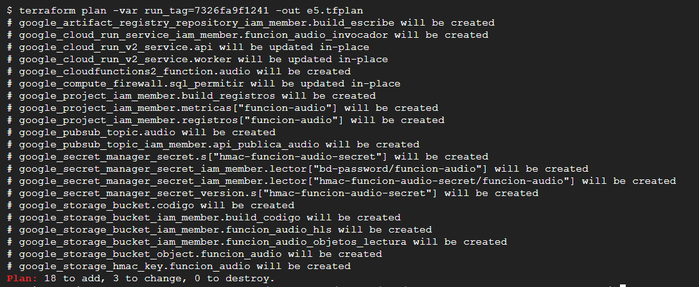

### 1.2 Apply

El primer `terraform apply` creó 16 de los 18 recursos y aplicó los 3 cambios.
La función falló con un `403` de Eventarc (*Caller does not have required
permission to use project… Propagation of the new permission may take a few
minutes*): la API de Eventarc se acababa de habilitar. Sin tocar nada a mano,
un segundo `plan` mostró solo los 2 recursos pendientes y el `apply` los creó:

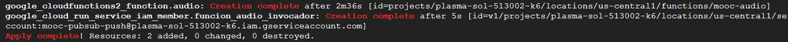

La función quedó así (`gcloud functions describe mooc-audio`):

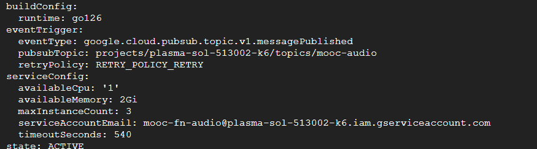

### 1.3 Actualización

Se cambió `funcion_audio.max` de 3 a 2 en `terraform.tfvars`. El `plan`
muestra un solo cambio en sitio y el `apply` lo aplica:

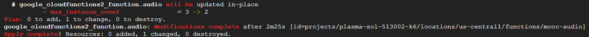

Después se devolvió a 3 con el mismo `plan` y `apply` (el valor por defecto).

### 1.4 La función en la consola

Servicio de Cloud Run creado por Cloud Functions, con su activador de
Eventarc: proveedor Cloud Pub/Sub, evento `messagePublished`, origen el topic
`mooc-audio`.

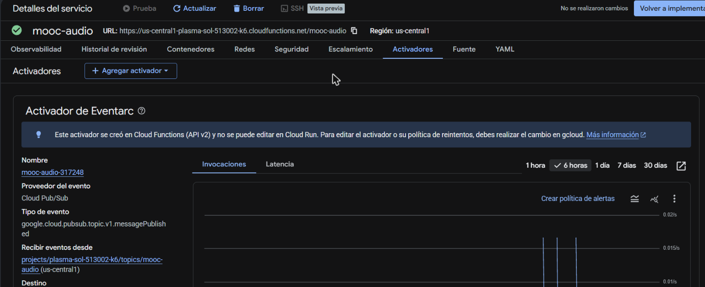

### 1.5 El mismo despliegue desde GitHub Actions

El flujo `Desplegar en GCP` (acción `infra`) hace el mismo `plan` y `apply`
con la cuenta `mooc-deployer` (Workload Identity Federation). Su plan, generado
cuando en el proyecto solo faltaban la función y su invocador:

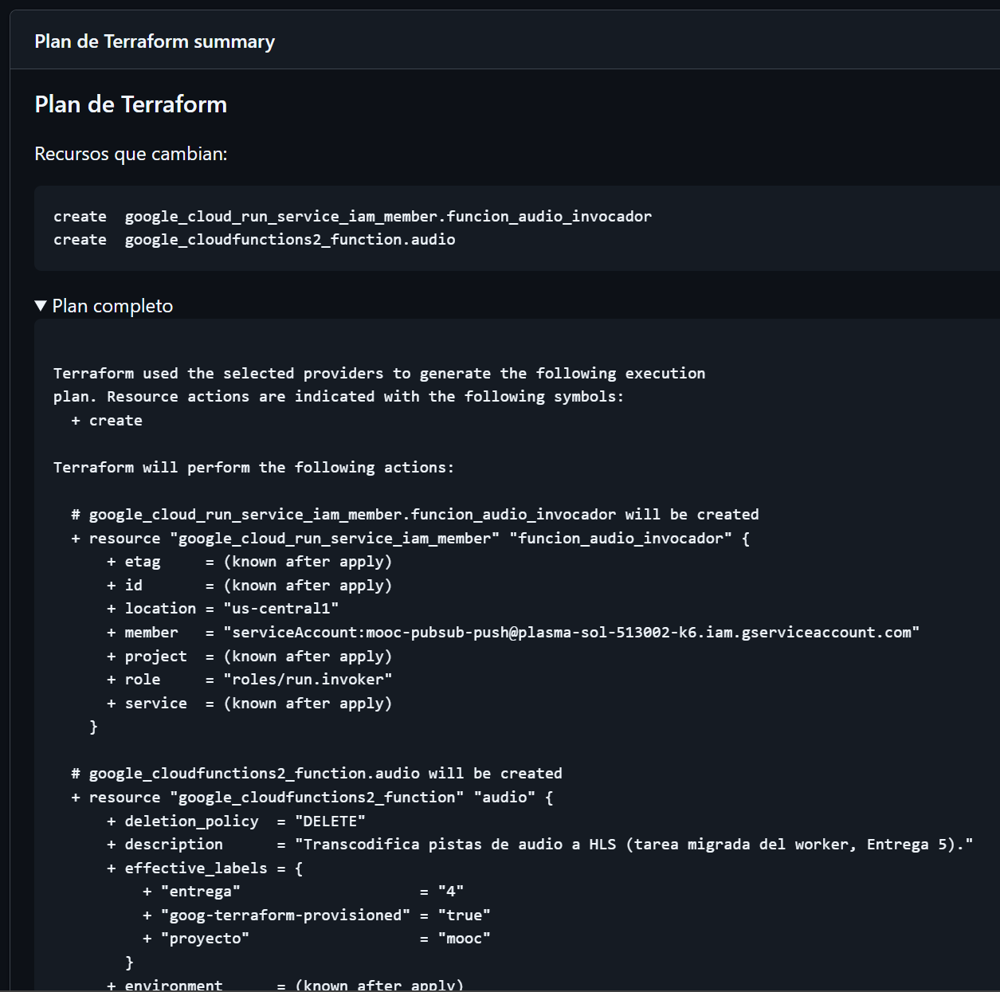

Y su `apply`, que ya no tuvo nada que crear porque el segundo `apply` de la
sección 1.2 había terminado (`0 added, 0 changed, 0 destroyed`): el código y
la infraestructura coinciden.

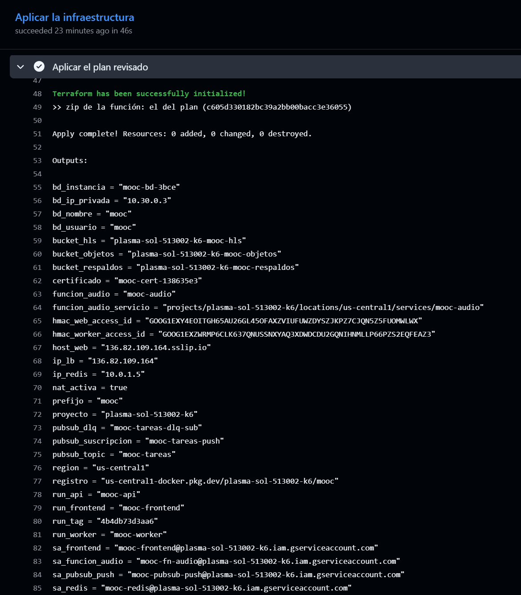

### 1.6 Cuentas de servicio y APIs gestionadas por Terraform

Las 7 cuentas de servicio ya existían (las había creado `bootstrap-ci.sh`).
Con el cambio de `identidades.tf` y `apis.tf`, el `plan` mostró
`7 to import, 20 to add, 0 to change, 0 to destroy`: importa las cuentas al
estado sin tocarlas y registra las 19 APIs y el rol de Cloud Build de
`mooc-build`. El `apply`:

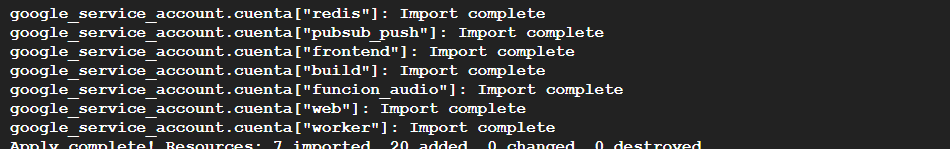

Un segundo `terraform plan` con el mismo código respondió `No changes. Your
infrastructure matches the configuration.`

## 2. Tarea real: Pub/Sub → función → resultado

Curso borrador "Entrega 5 - Audio en una Cloud Function", recurso de tipo
audio, archivo WAV de 90 s subido desde la plataforma.

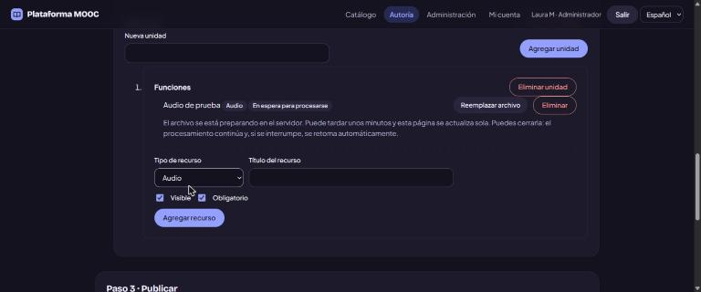

Recorrido en Cloud Logging. Mismo mensaje `23397309016945104` de punta a punta:
`mooc-api` publica en `mooc-audio` (03:35:00 UTC) y la función lo recibe,
transcodifica, publica el HLS, marca el activo como listo y confirma
(03:35:09 UTC). 8 segundos.

```bash
gcloud logging read '(jsonPayload.accion=~"queue.task_" OR jsonPayload.message=~"^media:|^audio:")
  AND (resource.labels.service_name="mooc-audio" OR jsonPayload.topic="mooc-audio")' \
  --freshness 30m --order asc \
  --format 'value(timestamp.date("%H:%M:%S"),resource.labels.service_name,jsonPayload.message_id,jsonPayload.topic,jsonPayload.message)'
```

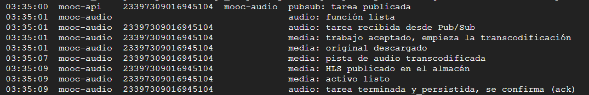

Resultado en `gs://plasma-sol-513002-k6-mooc-hls/hls/1fd8734f-0f6a-4f12-9dde-8fc604174a45/`:
`master.m3u8`, `audio.m3u8` y 16 segmentos, la misma estructura que producía
el worker.

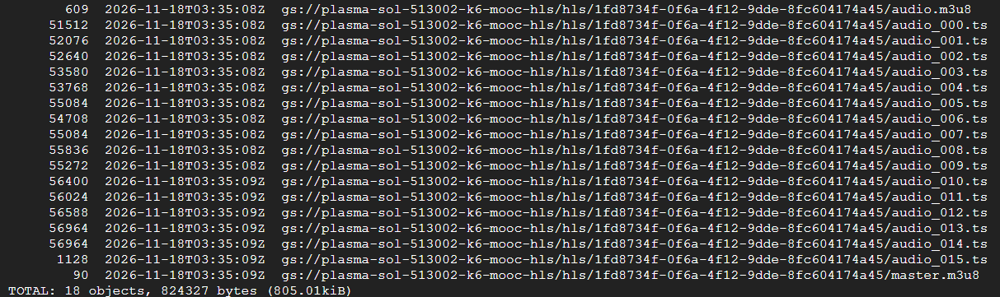

En la plataforma el recurso pasa a **Listo**:

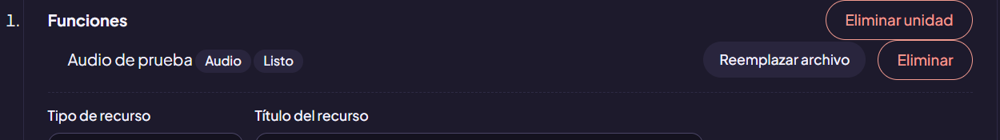

Una segunda prueba independiente, a las 04:01 UTC, con los registros de la
función de principio a fin (recibida, aceptada, original descargado, pista
transcodificada, HLS publicado, activo listo y `queue.task_acked`):

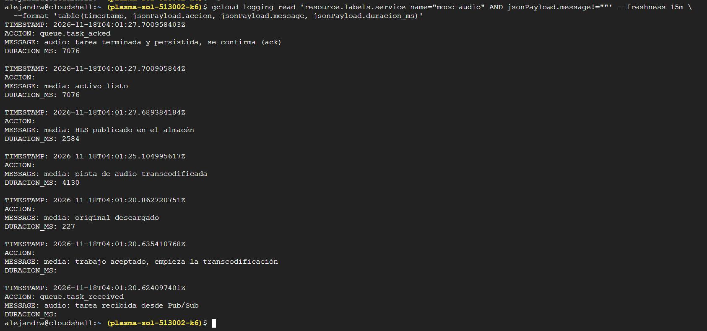

## 3. El worker ya no ejecuta la tarea

`mooc-api` y `mooc-worker` tienen `PUBSUB_TOPIC_AUDIO=mooc-audio`. El mensaje
del audio aparece 1 vez en `mooc-api` (publicación) y 7 veces en `mooc-audio`;
ninguna en `mooc-worker`.

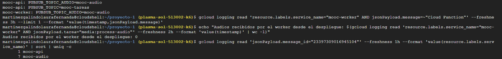

## 4. Reentrega sin duplicados

Se publicó a mano en `mooc-audio` el mismo trabajo (mismo payload y misma
`clave_idempotencia`):

```bash
gcloud pubsub topics publish mooc-audio \
  --message '{"task_id":"<activo>","media_asset_id":"<activo>","resource_id":"<recurso>","source_object_key":"resources/<recurso>/original","kind":"audio"}' \
  --attribute tipo=media:process-audio,clave_idempotencia=<activo>
```

La función recibe el mensaje nuevo `23506485779032885`, encuentra el activo
listo, registra `media: entrega duplicada descartada` y confirma. El listado
del bucket antes y después es idéntico (`diff` sin diferencias): mismos 18
objetos, mismas fechas.

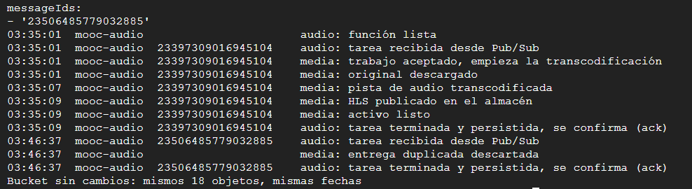

## 5. Video

Enlace en el [README](README.md) (máximo 20 min): migración, `terraform
plan`/`apply` y la tarea por Pub/Sub y la función.
